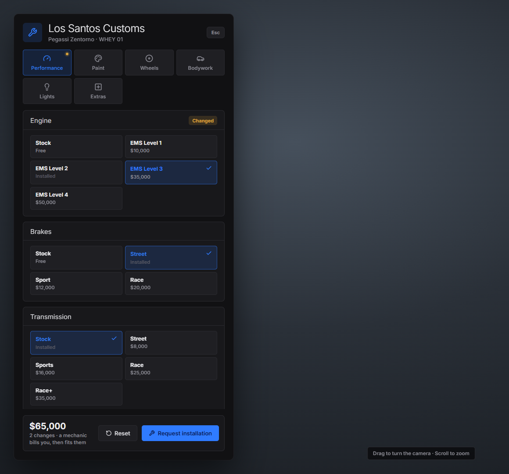
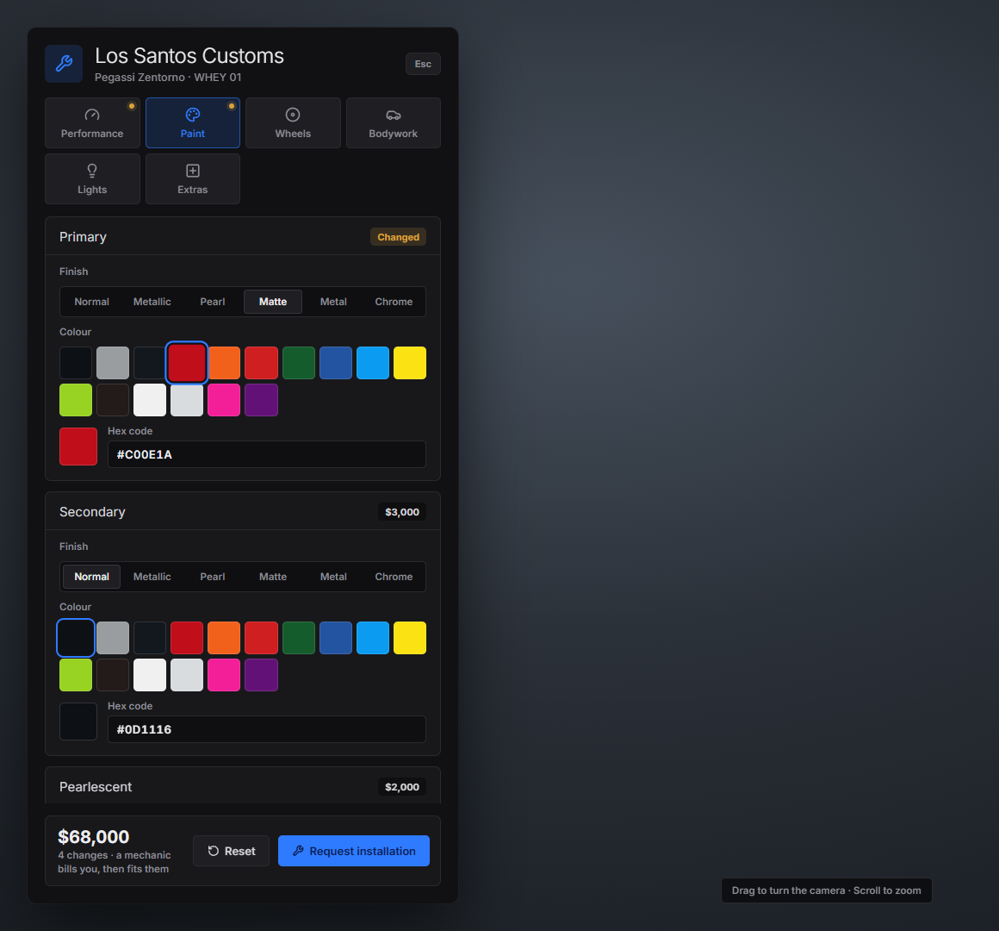
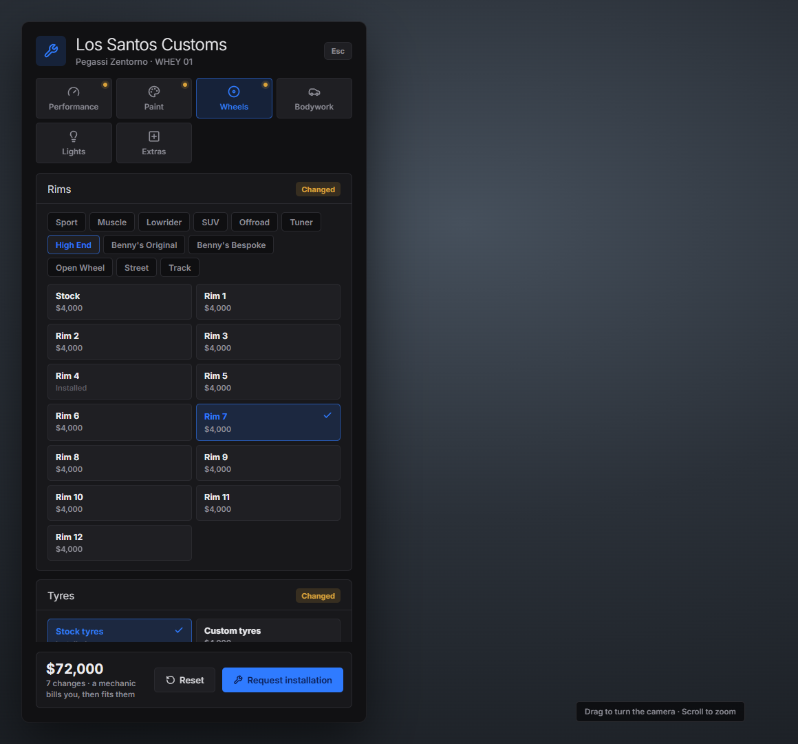
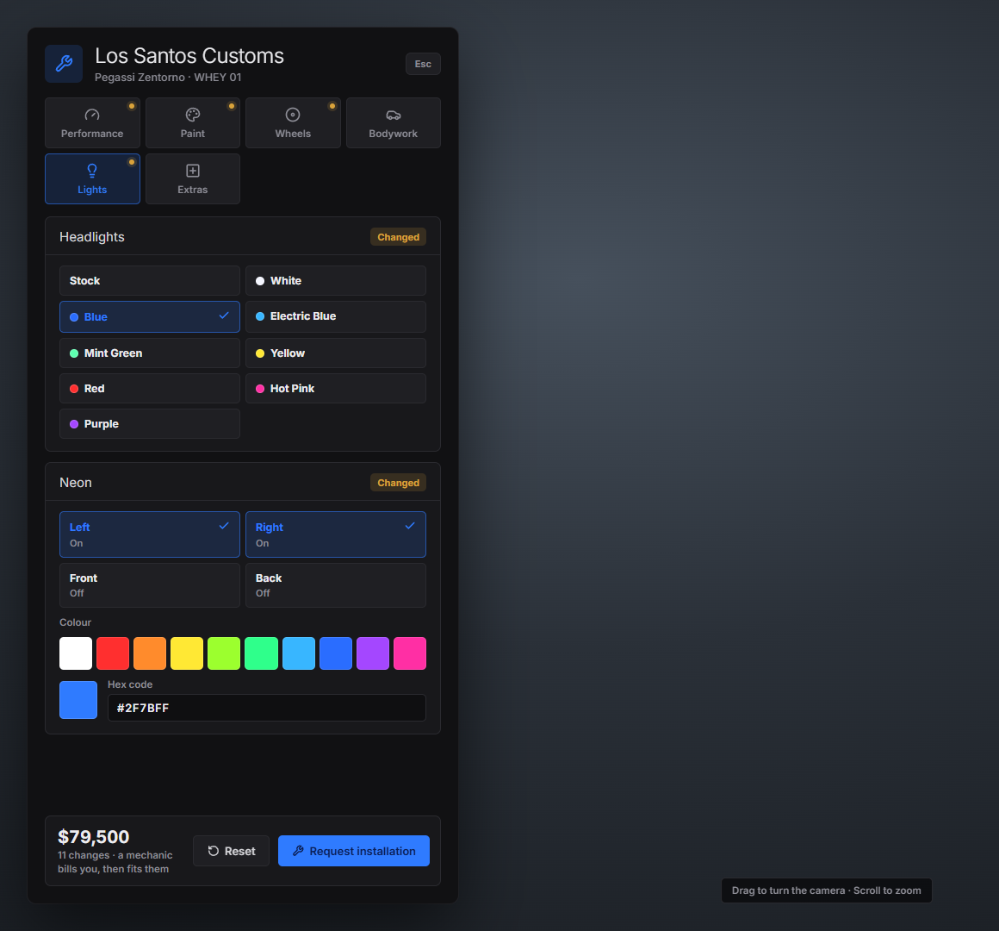
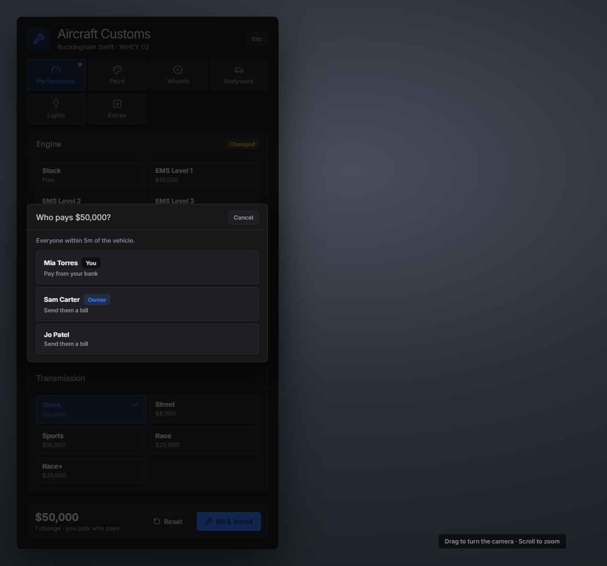
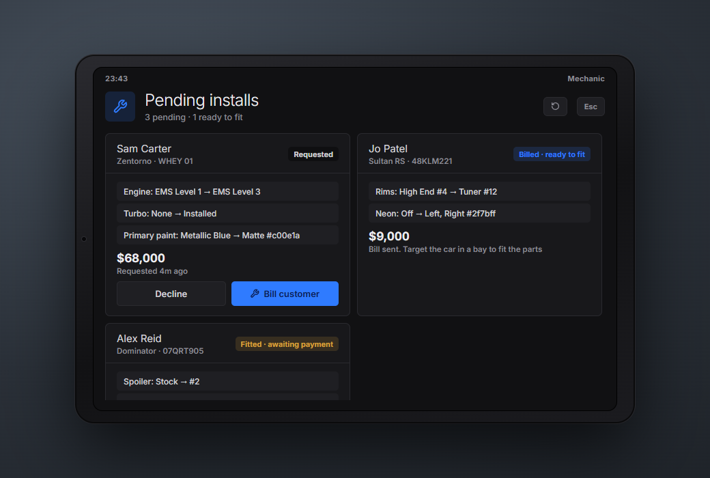
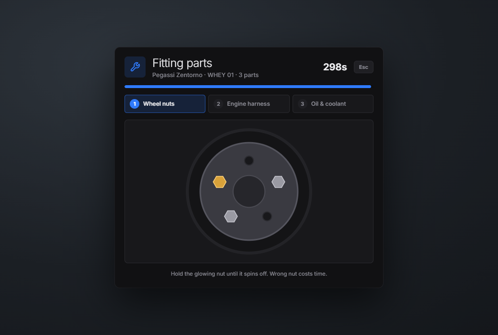
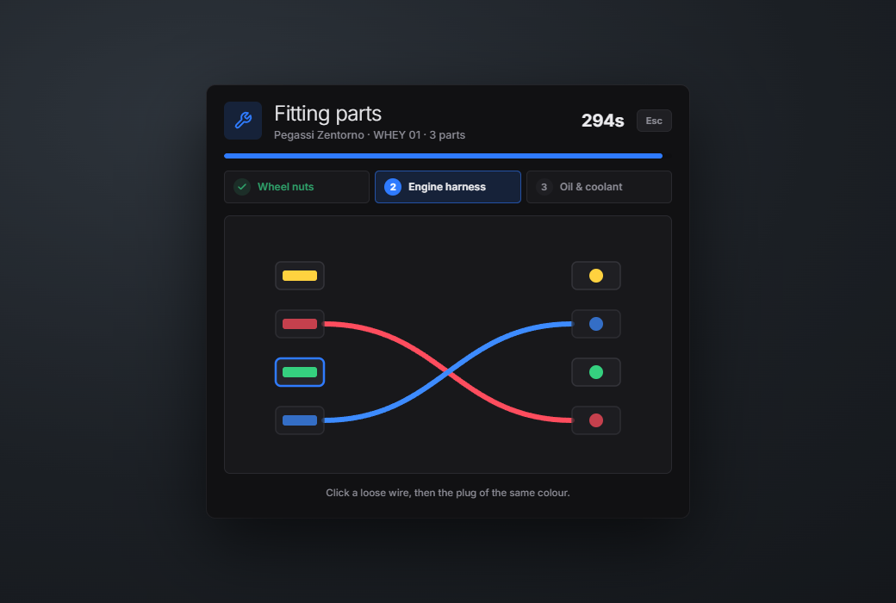
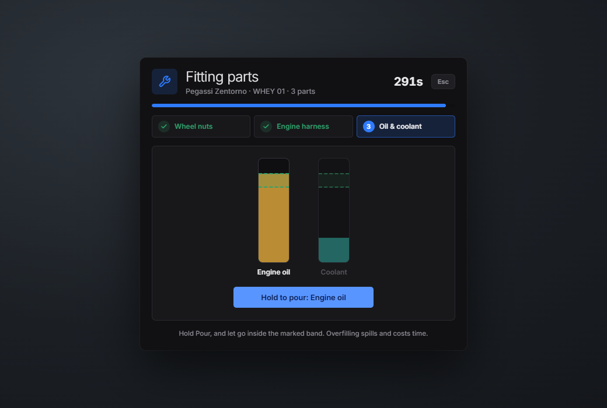
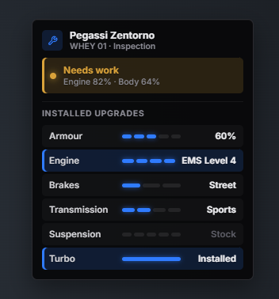

# whey_mechanic

A mechanic job for Qbox. Customers pick parts in a customs menu with a live preview, a mechanic bills them from a tablet and fits the parts at the car with three small jobs against the clock. It also covers repairs, repair kits, cleaning, invoices, a parts counter and a vehicle inspection card.

## Screenshots

The pictures show the interface on a plain background. In game it sits over the world, with the camera on the vehicle.

### The customs menu

Sit in the driver seat inside a shop and press **E**. The camera moves to the part you are changing and every change is previewed on the vehicle. Nothing is saved until it is paid for.



Paint has six finishes, a colour palette and a hex code field.



Rims by wheel type, tyres and tyre smoke.



Headlight colours and neon.



At shops that bill a person, you pick who pays out of the people standing by the vehicle.



### The install tablet

Mechanics see every part request, bill the customer and follow it until the parts are fitted and paid.



### Fitting the parts

Three jobs on one clock. A mistake costs time and running out cancels the installation.







### Inspection

Anyone can inspect a vehicle to see its condition and performance upgrades.



## Features

- **Customs shops.** Performance, paint, wheels, bodywork, interior, lights, windows, plates, liveries, extras and horns, with a camera that follows the part and a live preview.
- **Part requests.** At a request shop the customer only asks for parts. A mechanic bills them from the tablet and fits the parts at the car. Parts fitted before the bill is paid come off again if the bill is declined.
- **Other shop types.** A shop can also charge the driver straight away, or let whoever is in the menu pick who pays.
- **Aircraft shop.** Helicopters and planes have their own shop. Weapons and countermeasures can never be fitted.
- **Tax and commission.** Each shop can send a share of every payment away as tax and pay a share to the mechanic who fitted the parts.
- **Repairs.** On-duty mechanics repair for free. Everyone else uses a repair kit. Mechanics can sell their kits to a customer on the spot.
- **Cleaning** with a cloth, **invoices** at fixed prices, and a **parts counter** where mechanics buy stock with the business account.
- **Inspection card** for anyone, from the vehicle target or a command.
- **Server side checks on everything.** Prices, distances, jobs, ownership, items and timers are checked on the server. The client never sends a price.
- **Five languages.** English, Spanish, French, German and Brazilian Portuguese.

## Dependencies

| Resource | Needed |
|---|---|
| [qbx_core](https://github.com/Qbox-project/qbx_core) | Yes |
| [qbx_vehicles](https://github.com/Qbox-project/qbx_vehicles) | Yes |
| [ox_lib](https://github.com/overextended/ox_lib) | Yes |
| [oxmysql](https://github.com/overextended/oxmysql) | Yes |
| [ox_inventory](https://github.com/overextended/ox_inventory) | Yes |
| [ox_target](https://github.com/overextended/ox_target) | Yes |
| [Renewed-Banking](https://github.com/Renewed-Scripts/Renewed-Banking) | For the business account, unless you change `config/banking.lua` |
| [qbx_vehiclekeys](https://github.com/Qbox-project/qbx_vehiclekeys) | Only for shops with `ownerOrKeys`, so key holders can customize too |

OneSync must be on. All of these come with the standard Qbox recipe.

## Installation

1. Download the resource and put the `whey_mechanic` folder in your `resources` folder. Keep the folder name.
2. Add it to `server.cfg` after its dependencies:
   ```
   ensure whey_mechanic
   ```
3. Add the three items below to ox_inventory and restart it.
4. Set your job and account in `config/general.lua` (see Configuration).
5. Start the server. The database table is created automatically. There is no SQL file to import.

The interface is already built. You do not need Node.js to run the resource.

## Items

Add these to `ox_inventory/data/items.lua` and restart ox_inventory. Put a picture for each in `ox_inventory/web/images`, named after the item.

```lua
['repair_kit'] = {
    label = 'Repair Kit',
    weight = 2500,
    stack = true,
    close = true,
    description = 'Fixes a vehicle. Used up.',
    client = {
        export = 'whey_mechanic.useRepairKit',
    },
},

['cloth'] = {
    label = 'Cloth',
    weight = 100,
    stack = true,
    close = true,
    description = 'Cleans a vehicle.',
    client = {
        export = 'whey_mechanic.useCloth',
    },
},

['mechanic_tablet'] = {
    label = 'Mechanic Tablet',
    weight = 500,
    stack = false,
    close = true,
    description = 'Shows part requests waiting to be billed and fitted.',
    client = {
        export = 'whey_mechanic.useTablet',
    },
},
```

To use other item names, change `Config.Repair.kit`, `Config.Clean.item` and `Config.Install.item`.

## Configuration

All settings are in the `config` folder. Every option has a comment next to it.

| File | What is in it |
|---|---|
| `config/general.lua` | The job, the business account, the boss ring, inspection, repairs, cleaning, the install tablet and jobs, billing distances. |
| `config/shops.lua` | The customs shops, the parts counter, repair kit sales and invoices. |
| `config/prices.lua` | The price of every change in the customs menu. |
| `config/banking.lua` | How money goes in and out of the business account, and how bills are sent. |
| `config/logs.lua` | A function called for everything worth a log line. Empty by default. |

### The job and the account

`Config.Job` is the Qbox job that counts as a mechanic. The default is `mechanic`, which is in Qbox's `jobs.lua` already.

`Config.Account` is the business account that pays for stock and receives invoices and kit sales. Each shop has its own `account` for customs payments. With Renewed-Banking a job's account has the same name as the job, so the default `mechanic` works out of the box.

### Shop types

| Setting | What happens |
|---|---|
| `requests = true` | The customer requests parts. A mechanic bills them from the tablet and fits the parts at the car. |
| `billing = 'driver'` | The driver pays from their bank and the parts go on straight away. Good for a self-service shop. |
| `billing = 'owner'` | Whoever is in the menu picks who pays out of the people by the vehicle. Good with `job` set, so a mechanic works the menu. |

### Banking and bills

Business accounts go through the three functions in `config/banking.lua`. Change them to use another banking resource. Player money always goes through qbx_core.

By default the resource sends its own bill: the customer gets a prompt with every line and the total, and accepting pays from their bank. To use your own billing resource instead, set `sendBill` in the same file and report the result back with `exports.whey_mechanic:resolveBill(id, 'paid')` or `'declined'`. The file explains both.

### Languages

English (`en`), Spanish (`es`), French (`fr`), German (`de`) and Brazilian Portuguese (`pt-br`) are included. Pick one in `server.cfg`:

```
setr ox:locale es
```

This is the ox_lib language setting, so it changes every ox resource on the server at the same time. To add another language, copy `locales/en.json` to a new file such as `locales/it.json` and translate the right hand side. Keep every `%s` and `%d` in the same order.

The names of your shops and invoice lines are in `config/shops.lua`.

## Using it

**Customers**

1. Park in a bay at the shop, stay in the driver seat and press **E**.
2. Pick parts and press **Request installation**. The vehicle goes back to how it was.
3. Pay the bill a mechanic sends you. They fit the parts at the car.

**Mechanics**

1. Go on duty and buy a tablet and repair kits at the parts counter.
2. Open the tablet with the item or `/mods`. Press **Bill customer** on a request.
3. Once the bill is sent, target the car in a bay and choose **Start installation**. Finish the three jobs before the clock runs out.
4. Target a vehicle to repair it or sell a repair kit. Target a player to send an invoice.

**Everyone**

- Target a vehicle and choose **Inspect**, or use `/inspect`.
- Use a repair kit or a cloth next to a vehicle.

## Database

The resource creates one table on first start, `whey_mechanic_requests`, which keeps part requests across restarts. Vehicle mods are saved through qbx_vehicles into `player_vehicles`.

## Editing the interface

The interface is TypeScript, built with Vite. The source is in `web/src` and the built files are in `web/dist`.

```
cd web
npm install
npm run build
```

## Support

Open an issue on the [GitHub repository](https://github.com/wheylovesprotein/whey_mechanic) with your server console output and the steps that lead to the problem. Set `Config.Debug = true` in `config/general.lua` first to get more detail.

## Credits

- Made by **wheylovesprotein**.
- Built on [ox_lib](https://github.com/overextended/ox_lib), [ox_inventory](https://github.com/overextended/ox_inventory), [ox_target](https://github.com/overextended/ox_target) and [qbx_core](https://github.com/Qbox-project/qbx_core).
- Icons by [Lucide](https://lucide.dev). The font is Inter, under the SIL Open Font License.

## License

Free to use and modify on any server. You may not sell it or put it behind a paywall. See [LICENSE](LICENSE).
